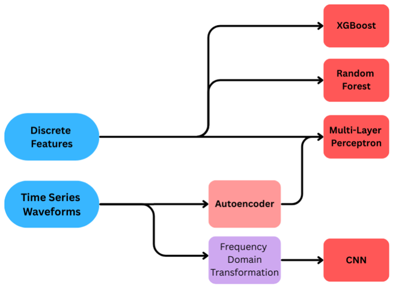

# EMG-Based Biometric Authentication

Can the electrical signals from your forearm muscles identify who you are?
This project explores surface EMG (sEMG) as a biometric, using the GRABMyo dataset.

Group project for **EEE 598: Biomedical Machine Learning, Arizona State University (Fall 2025)**.
Team: Carter Meyers, Noah Rajbharti, Sushma Niresh.



## Why EMG for authentication
Passwords and SMS-based second factors are the main target of identity attacks.
sEMG signals depend on each person's muscle anatomy and how they move.
That makes them hard to steal or replay, and they can be captured with a wearable armband.

## Dataset
[GRABMyo](https://physionet.org/content/grabmyo/1.1.0/) on PhysioNet:
- 43 healthy participants, each recorded on 3 different days
- 32 sEMG channels: 16 on the forearm and 12 near the wrist, plus 4 unused channels
- Sampled at 2048 Hz, hardware band-pass filtered 10–450 Hz
- 16 hand gestures plus rest, 7 trials each, 5 seconds per trial

The dataset (about 9 GB) is **not included** in this repo. Download it from PhysioNet and extract it to `grabmyo_dataset/`.

## What's here

| File | What it does |
|---|---|
| `notebooks/01_feature_extraction_random_forest.ipynb` | Loads every session-1 recording with `wfdb`, extracts per-channel time-domain features (mean, std, RMS, skewness, kurtosis, and others), trains a Random Forest to identify the participant, and plots a PCA of the features |
| `notebooks/02_signal_exploration_filtering.ipynb` | Signal exploration: plots raw channels, applies band-pass and notch filtering, cuts 250 ms windows with 50% overlap, and computes Welch power spectra per channel |
| `experimental/emg_id_cnn.py` | Work in progress: a 1D-CNN training script with windowing, per-channel z-scoring, augmentation, and train-on-some-sessions / test-on-another evaluation. It is a template and is not yet adapted to GRABMyo's 32 channels at 2048 Hz, so there are no results from it yet |

## Results so far

**Identifying users with a Random Forest on hand-crafted features:**
- Data: session 1, all 43 participants
- Split: random 80/20 train/test split (Random Forest, 100 trees)
- **76% accuracy, 0.75 macro F1** on 1,024 test recordings
- Accuracy per participant ranged from 0.41 to 0.98

**Read this number carefully:**
- This is **identification** (which of 43 people is this?), not **verification** (is this the claimed user?). Authentication is usually reported as EER, FAR and FRR, which this notebook does not compute yet.
- Training and test data come from the **same recording session**. Signals change from day to day, so testing on a different day is the realistic and harder setting.

## Planned next steps (from the project proposal)
1. Pick a smaller set of electrodes using muscle anatomy and per-electrode power (ANOVA), to show that a few well-placed sensors are enough.
2. Turn spectral features into a 2D CNN.
3. Evaluate as authentication, with EER, FAR and FRR, comparing against prior work (Said et al. 2020, FAR about 2%; Pradhan et al. 2022, EER 2.7%).
4. Train on two days and test on the third.

## Setup
```bash
pip install -r requirements.txt
# download GRABMyo from PhysioNet into grabmyo_dataset/
jupyter notebook notebooks/
```
